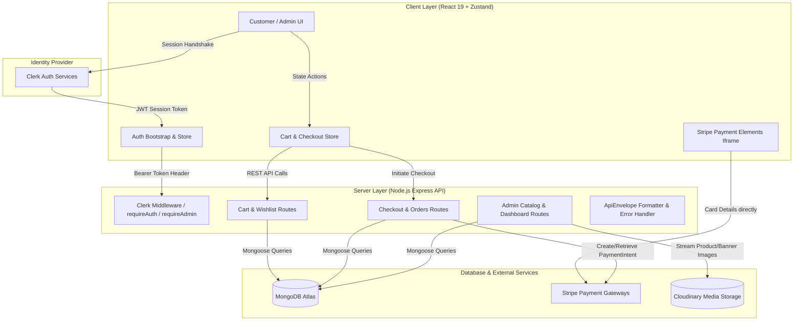
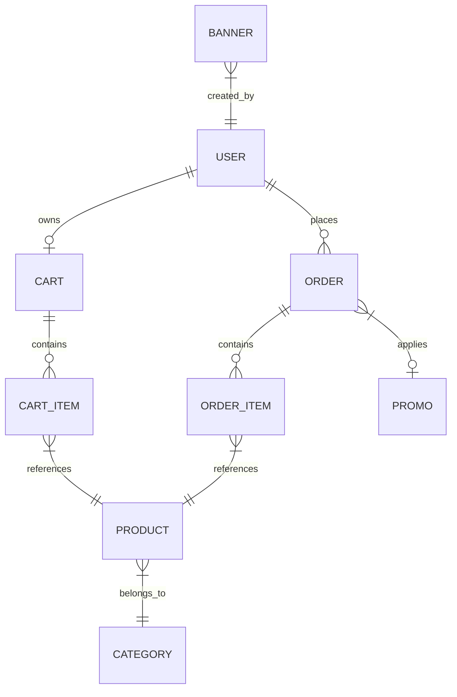

# Complete Interview Master Guide: Full-Stack E-Commerce Platform

This document is your complete, end-to-end interview companion for this Full-Stack E-Commerce application. It covers everything from high-level system architecture down to concrete code implementations, data flows, and interview answers.

---

## 1. Project Overview & Elevator Pitches

### 30-Second Elevator Pitch
> *"I built a full-stack, dual-portal E-Commerce platform called CartCraze using React 19, TypeScript, Node.js, Express, and MongoDB. It features a modern customer storefront and a full-featured admin management portal. Key technical highlights include seamless guest-to-authenticated cart synchronization, a loyalty points and discount engine, PCI-compliant Stripe Payment Elements integration, and secure role-based access control powered by Clerk Auth."*

### 2-Minute In-Depth Technical Pitch
> *"The project is architected as a decoupled client-server application. On the frontend, I used React 19 with TypeScript, Vite, Tailwind CSS, shadcn/ui, and Zustand for lightweight, modular state management. On the backend, I built a RESTful API with Node.js, Express, TypeScript, and Mongoose ODM for MongoDB.*
>
> *I paid special attention to real-world e-commerce edge cases:
> 1. **Guest Cart Friction Removal**: Guests can browse and add items to a local storage cart without signing in. Upon login or registration via Clerk, a custom cart synchronization algorithm merges their local items with their persistent MongoDB cart, validating stock and variants.
> 2. **Security & PCI Compliance**: For credit card payments, I implemented Stripe Payment Elements. Card numbers are collected inside Stripe's sandboxed iframe and never touch our servers. On confirmation, the backend independently queries Stripe's servers to verify payment success before decrementing inventory and completing the order.
> 3. **Loyalty & Promotion Engine**: Customers can redeem promotional discount coupons (validated against expiry dates, usage counters, and minimum order values) and spend accumulated loyalty points directly at checkout with automated rollback mechanisms if item stocks become unavailable.
> 4. **Administrative Controls**: Administrators have role-guarded access to real-time sales dashboards, product inventory management with Cloudinary image uploads via memory buffers, coupon generators, banner controls, and order status lifecycle updates."*

---

## 2. Technology Stack & Design Decisions

| Layer | Technologies | Why This Choice? |
| :--- | :--- | :--- |
| **Frontend Framework** | React 19 + TypeScript + Vite | Blazing fast HMR, strong compile-time type safety, modern concurrent rendering features. |
| **Styling & UI Components** | Tailwind CSS + `shadcn/ui` (Radix UI primitives) + Lucide Icons | Accessible, headless, fully customizable design system with zero runtime CSS overhead. |
| **Client State Management** | Zustand | Lightweight (sub-2KB), boilerplate-free alternative to Redux; separates concerns cleanly across feature stores (`useAuthStore`, `useCustomerCartAndCheckoutStore`, etc.). |
| **Authentication** | Clerk Auth (`@clerk/react`, `@clerk/express`) | Out-of-the-box secure authentication, session management, social login, and cryptographic JWT issuance. |
| **Backend API** | Node.js + Express + TypeScript | Non-blocking asynchronous I/O, rapid REST endpoint construction, unified TypeScript types across client and server. |
| **Database & ODM** | MongoDB Atlas + Mongoose ODM | Flexible document schema well-suited for nested sub-documents (cart items, order line items, addresses) with compound indexing. |
| **Payment Gateway** | Stripe SDK (`@stripe/react-stripe-js`, `stripe`) | Industry-standard payment provider supporting PCI-DSS Level 1 compliance through `PaymentElement` iframes. |
| **Media Storage** | Cloudinary API + `multer` (memory storage) + `streamifier` | Offloads static image assets and image transformation from the application server; files are buffered in memory and streamed directly to Cloudinary. |

---

## 3. High-Level Architecture & End-to-End System Flow



---

## 4. Deep Dive: Key Modules & How They Link Together

### 4.1. Authentication & Role-Based Access Control (RBAC)
* **Client Handshake**: When the app loads, `useBootstrapAuth` in [BootstrapAuth.ts](file:///c:/Ashish/E-Commerce/client/src/features/auth/BootstrapAuth.ts) configures the Axios request interceptor with Clerk's `getToken()`. Every outgoing backend request automatically includes `Authorization: Bearer <Clerk_JWT>`.
* **Server Verification**: In [auth.ts](file:///c:/Ashish/E-Commerce/server/src/middleware/auth.ts), `clerkMiddleware()` intercepts the token and `requireAuth` ensures `userId` exists.
* **Database User Synchronization**: In [auth.routes.ts](file:///c:/Ashish/E-Commerce/server/src/routes/auth/auth.routes.ts), `POST /auth/sync` is called immediately upon login. It fetches user metadata from Clerk, checks if the email exists in `ADMIN_EMAILS`, and creates or updates a matching document in MongoDB with role `"customer"` or `"admin"`.
* **Route Protection**:
  * Frontend: `ProtectedLayout` redirects unauthenticated users; `RoleGuardLayout allow={["admin"]}` prevents non-admins from rendering `/admin/*`.
  * Backend: `requireAdmin` middleware checks `extractCurrentDbUser.role === "admin"`. If unauthorized, it rejects the request with HTTP 403.

### 4.2. Dual-Storage Cart & Cart Synchronization Algorithm
* **The Problem**: If a guest adds items to their cart and then logs in, standard apps often erase the guest cart or fail to reconcile stock.
* **The Solution**:
  1. **Guest Mode**: Guest actions write to `localStorage` under `guest_cart_items`.
  2. **Sign-In Trigger**: In [store.ts](file:///c:/Ashish/E-Commerce/client/src/features/customer/cart-and-checkout/store.ts), `loadCart(isSignedIn)` checks if `isSignedIn` is true and guest items exist in `localStorage`.
  3. **Sync API**: Dispatches `POST /customer/cart/sync` to [cart-wishlist.routes.ts](file:///c:/Ashish/E-Commerce/server/src/routes/customer/cart-wishlist.routes.ts).
  4. **Merge Logic**: The server matches incoming items with existing DB cart items by `productId`, `color`, and `size`:
     - If the item already exists in DB: quantities are summed up, clamped to available stock (`Math.min(nextQuantity, product.stock)`).
     - If the item is new: it is appended to the user's cart items array.
  5. **Purge**: On success, the client deletes `guest_cart_items` from `localStorage` and loads the unified cart.

### 4.3. Pricing, Promotions, and Currency Precision
* **Floating-Point Bug Prevention**: In JavaScript, `0.1 + 0.2 !== 0.3`. To prevent rounding bugs, all prices in database models are stored in base currency units, and total amounts passed to Stripe are explicitly multiplied into subunits (paise/cents).
* **Discount Calculation**:
  $$\text{Final Price} = \text{Product Price} \times \left(1 - \frac{\text{Sale Percentage}}{100}\right)$$
  $$\text{Subtotal} = \sum (\text{Final Price} \times \text{Quantity})$$
  $$\text{Discount} = \text{Subtotal} \times \left(\frac{\text{Promo Percentage}}{100}\right)$$
  $$\text{Total} = \max(\text{Subtotal} - \text{Discount}, 0)$$
* **Coupon Validation Checklist**: In [checkout.routes.ts](file:///c:/Ashish/E-Commerce/server/src/routes/customer/checkout.routes.ts):
  - Is `now >= promo.startsAt && now <= promo.endsAt`?
  - Is `promo.count > 0`?
  - Is `subTotal >= promo.minimumOrderValue`?

### 4.4. Stripe Payment Elements & Secure Order Verification Flow

```mermaid
sequenceDiagram
    autonumber
    actor Customer as User Browser
    participant Store as Zustand Store
    participant Server as Express Server
    participant Stripe as Stripe API
    participant DB as MongoDB

    Customer->>Store: Clicks "Pay with Stripe"
    Store->>Server: POST /checkout/create-stripe-intent { addressId, promoCode }
    Server->>DB: Query Cart, Address, Products, & Promo
    Server->>Server: Re-verify stock & compute final server-side price
    Server->>Stripe: stripe.paymentIntents.create({ amount: totalAmount * 100, currency: "inr" })
    Stripe-->>Server: Returns { client_secret, id }
    Server->>DB: Order.create({ stripePaymentIntentId: id, paymentStatus: 'pending' })
    Server->>Stripe: stripe.paymentIntents.update(id, { metadata: { orderId } })
    Server-->>Store: Returns { clientSecret, paymentIntentId, orderId }
    Store->>Customer: Opens StripePaymentModal & mounts <PaymentElement>
    Customer->>Stripe: Submits Card Credentials inside iframe
    Stripe-->>Customer: Card processed; status = "succeeded"
    Customer->>Store: Triggers onSubmit callback
    Store->>Server: POST /checkout/confirm-stripe { orderId, paymentIntentId }
    Server->>Stripe: stripe.paymentIntents.retrieve(paymentIntentId)
    Stripe-->>Server: Returns PaymentIntent object
    Server->>Server: Validates intent.status === "succeeded" & metadata.orderId === orderId
    Server->>DB: Atomically decrement product stocks: Product.updateOne({ _id, stock: { $gte: qty } }, { $inc: { stock: -qty } })
    Server->>DB: Decrement promo count (if promo applied)
    Server->>DB: Cart.updateOne({ user }, { items: [] })
    Server->>DB: Order.updateOne({ _id }, { paymentStatus: 'paid', paidAt: now })
    Server-->>Store: Returns { _id }
    Store-->>Customer: Clears local cart & redirects to /order-success
```

### 4.5. Loyalty Points Program (Alternative Payment Route)
* In [checkout-with-point.routes.ts](file:///c:/Ashish/E-Commerce/server/src/routes/customer/checkout-with-point.routes.ts):
  - Conversion rate: **1 Point = 1 INR**.
  - Atomically checks and decrements user points:
    ```typescript
    await User.updateOne(
      { _id: dbUser._id, points: { $gte: totalAmount } },
      { $inc: { points: -totalAmount } }
    );
    ```
  - **Failure Rollback Safety**: If any product runs out of stock while completing the order loop, the catch block immediately refunds the points:
    ```typescript
    await User.updateOne({ _id: dbUser._id }, { $inc: { points: totalAmount } });
    ```

### 4.6. Admin Portal & Inventory Lifecycle
* **Dashboard Aggregations**: Uses MongoDB aggregation pipelines to calculate total revenue from paid orders (`$match: { paymentStatus: "paid" }, $group: { _id: null, totalSales: { $sum: "$totalAmount" } }`).
* **Cloudinary Media Buffer**: Images uploaded in the admin portal are kept in memory (`multer.memoryStorage()`) and uploaded directly to Cloudinary using readable streams via `streamifier`, avoiding temporary files on the local disk.
* **Order Status State Machine**:
  `placed` $\rightarrow$ `shipped` $\rightarrow$ `delivered` $\rightarrow$ `returned`
  - When marked `delivered`: records `deliveredAt = new Date()`.
  - When marked `returned`: atomically increments product stock back to inventory and refunds loyalty points if applicable.

---

## 5. Database Schema Relationships & Indexing Strategy



### Strategic Indexes:
1. `User.clerkUserId` (Unique): Instant $O(1)$ user resolution on every authenticated API request.
2. `Order.{ user: 1, createdAt: -1 }`: Fast retrieval of user order history sorted chronologically.
3. `Order.{ orderStatus: 1, createdAt: -1 }`: Optimizes admin order management tables.
4. `Product.{ category: 1, status: 1 }`: Fast catalog filtering for active products within a category.
5. `Promo.code` (Unique): Fast coupon validation during checkout.

---

## 6. High-Probability Interview Questions & Answers

### Q1: "How did you prevent price manipulation by malicious users?"
> **Answer:** *"The frontend never determines or sends final prices to the backend. When a customer checks out, the client only sends the `addressId` and optional `promoCode`. The backend independently fetches the user's cart from MongoDB, queries the current active product prices directly from the database, applies validated promo rules, and calculates the total amount on the server. That server-calculated total is what gets passed to Stripe when creating the PaymentIntent."*

### Q2: "Why did you choose Stripe Payment Elements over creating a custom form with your own inputs?"
> **Answer:** *"Handling raw credit card numbers requires strict PCI-DSS compliance, annual audits, and secure infrastructure. By using Stripe Payment Elements, the credit card inputs are rendered inside a sandboxed iframe hosted by Stripe. Card numbers travel directly from the customer's browser to Stripe's PCI-DSS Level 1 compliant vault. Our application server only receives a `paymentIntentId`, completely eliminating the liability of handling raw sensitive financial data."*

### Q3: "How do you handle race conditions when two users buy the last item in stock at the same time?"
> **Answer:** *"Instead of performing a 'read-then-write' pattern which is vulnerable to race conditions, I used atomic updates with condition checks in MongoDB:
> ```typescript
> Product.updateOne(
>   { _id: item.product, stock: { $gte: item.quantity } },
>   { $inc: { stock: -item.quantity } }
> );
> ```
> If two requests arrive concurrently for the last unit, only one update will match the `{ stock: { $gte: 1 } }` condition and return `matchedCount: 1`. The second request will have `matchedCount: 0`, causing our code to reject the transaction with an 'Out of stock' error."*

### Q4: "Why use Zustand instead of Redux Toolkit or Context API?"
> **Answer:** *"React Context re-renders all consumer components whenever any part of the context value changes, which creates performance bottlenecks in high-frequency state like carts and forms. Redux Toolkit, while powerful, introduces significant boilerplate (reducers, actions, dispatchers). Zustand provides a minimal, Hook-based store with automatic selector subscriptions (only components that select a specific slice re-render), zero boilerplate, and effortless integration outside React components."*

### Q5: "How does the guest cart merge into the authenticated cart when a user signs in?"
> **Answer:** *"We use a dual-storage strategy. Unauthenticated users store their items in `localStorage` under `guest_cart_items`. When the user signs in with Clerk, our `useBootstrapAuth` hook authenticates the session, and `loadCart` in our Zustand store detects the presence of local items. It calls `POST /customer/cart/sync` with the guest payload. The backend iterates over the items, checks if each item (matching `productId`, `color`, and `size`) already exists in the user's MongoDB cart, sums the quantities up to the product's max available stock, saves the cart, and the client clears the local storage key."*

### Q6: "What happens if a network error occurs right after Stripe charges the user?"
> **Answer:** *"The order is created in MongoDB with `paymentStatus: 'pending'` before Stripe payment is completed, and the Stripe PaymentIntent stores our internal `orderId` in its metadata. If the client disconnects before `/checkout/confirm-stripe` finishes, Stripe webhooks can be configured to listen to `payment_intent.succeeded`, look up the order by metadata `orderId`, mark it as `paid`, and decrement stock asynchronously, ensuring no paid orders are lost."*
